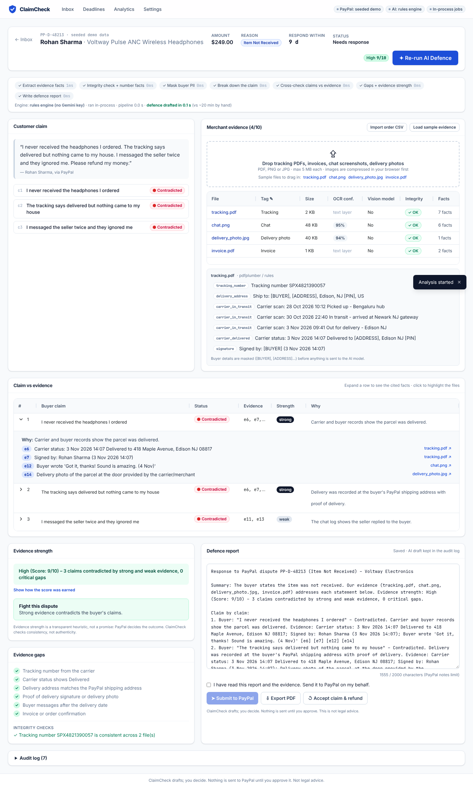
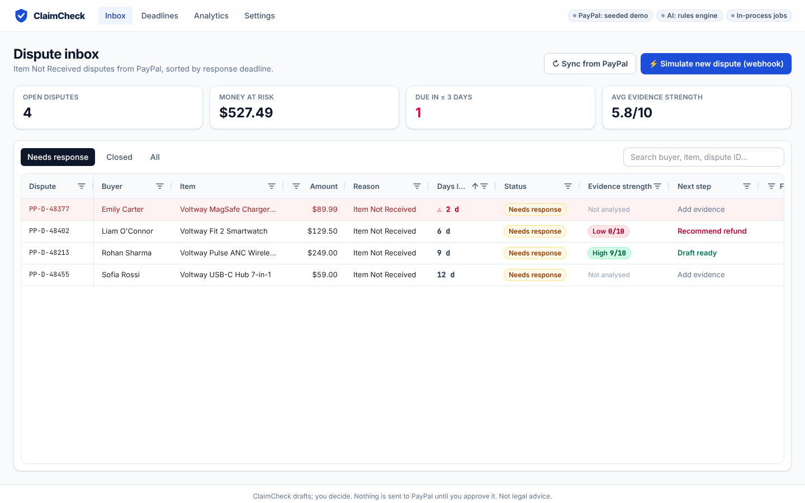
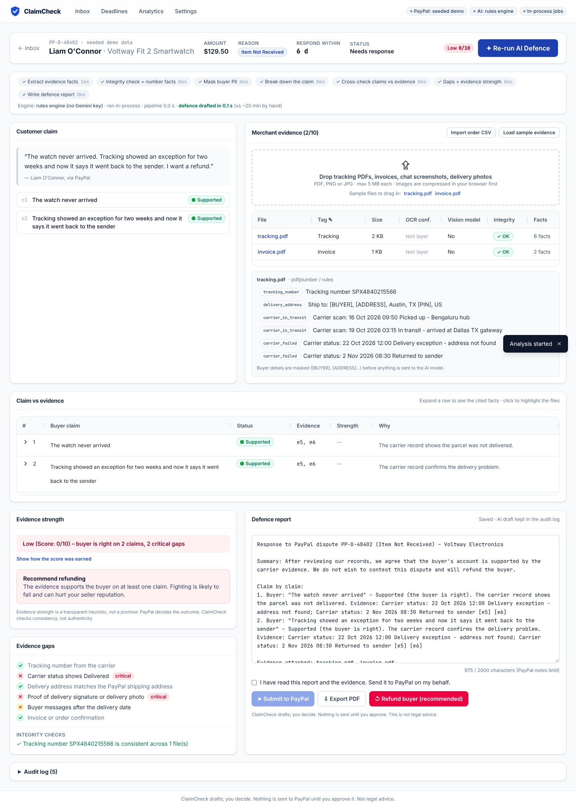
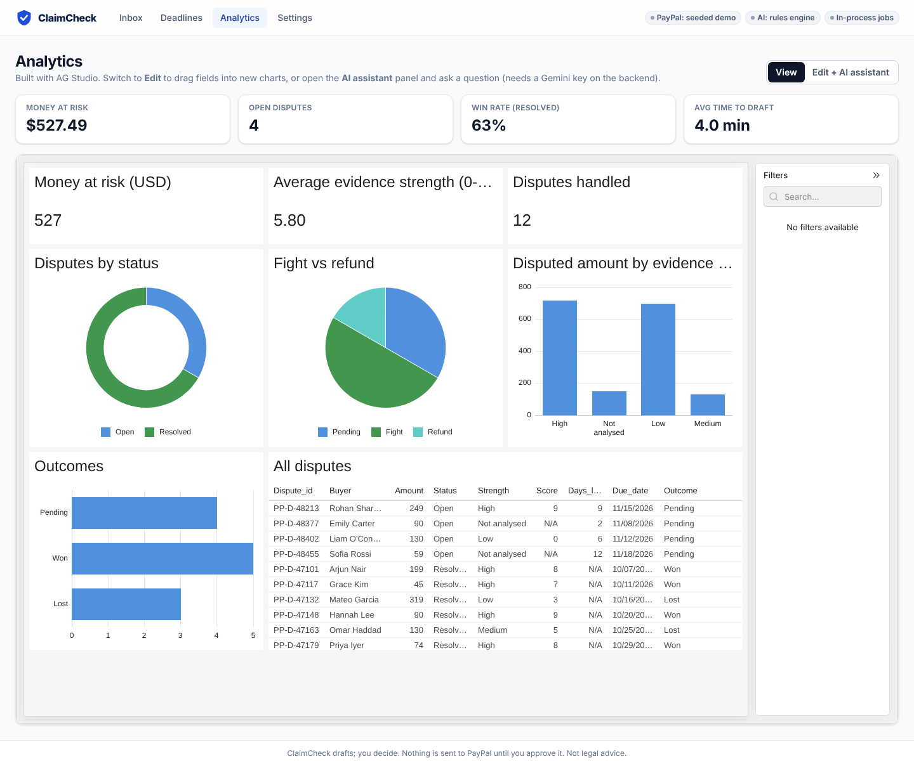
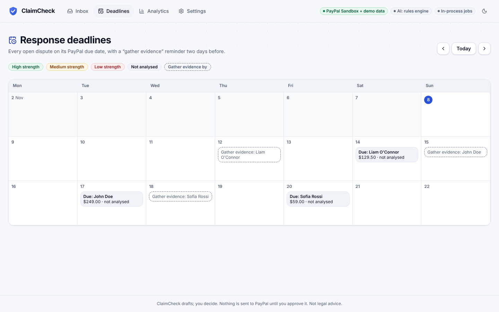

# ClaimCheck

**AI dispute defence for PayPal merchants.** ClaimCheck breaks a buyer's claim into separate statements, checks each one against the merchant's evidence, flags contradictions and gaps, and drafts an evidence-backed response. The merchant approves it before anything goes to PayPal.

Built for the **PayPal AI Hackathon 2026** (open track).



## What it does

1. **Dispute inbox**: syncs Item Not Received disputes from the PayPal Disputes API, sorted by response deadline. Rows turn red when 3 days or fewer are left.
2. **Evidence upload**: drag in tracking PDFs, invoices, chat screenshots and delivery photos (PDF/PNG/JPG, max 5 MB, max 10 files). Images are compressed in the browser first.
3. **Claim breakdown**: the buyer's message is split into atomic claims.
4. **Contradiction check**: each claim is marked 🔴 Contradicted, 🟢 Supported (the buyer is right) or ⚪ Unverified, with the evidence IDs that prove it.
5. **Evidence gaps**: a checklist for Item Not Received (tracking number, Delivered status, address match, signature or photo, buyer messages, invoice).
6. **Defence report + evidence strength**: an editable report and an explainable score, for example `High (Score: 9/10) – 3 claims contradicted by strong and weak evidence, 0 critical gaps`.
7. **Submit / refund**: send the report and files through `provide-evidence`, or refund through `accept-claim` when the buyer is right. Export the report as PDF.

There are three demo cases: **strong evidence** (PP-D-48213, merchant should win), **weak evidence** (PP-D-48377, a missing signature is flagged) and **buyer is right** (PP-D-48402, the parcel was returned to sender, so ClaimCheck recommends a refund).

## Quick start (local)

Requirements: Python 3.11+, Node 20+, and optionally Tesseract with the Hindi pack (`apt install tesseract-ocr tesseract-ocr-hin` / `brew install tesseract tesseract-lang`; on Windows, the UB Mannheim installer with Hindi ticked).

```bash
python -m venv .venv && source .venv/bin/activate
pip install -r backend/requirements-dev.txt
cd backend && uvicorn app.main:app --reload --port 8000
```

In a second terminal:

```bash
cd frontend && npm install && npm run dev
```

Open http://localhost:5173. With no keys set, ClaimCheck runs on seeded PayPal-shaped disputes and a rules engine, so the whole flow works offline. Open a dispute, click **Load sample evidence**, then **Generate AI Defence**.

Run the tests:

```bash
cd backend && python -m pytest -q
```

### Configuration

| Variable | Default | What it does |
|---|---|---|
| `PAYPAL_MODE` | `mock` | `mock` = seeded disputes in the PayPal JSON shape; `sandbox` = real PayPal Sandbox; `hybrid` = both in one inbox, each labelled (the live site uses this) |
| `SANDBOX_ACTIONS_KEY` | – | Optional: asked before Submit/Refund on real Sandbox disputes, so visitors can't use them up |
| `PAYPAL_CLIENT_ID` / `PAYPAL_CLIENT_SECRET` | – | Sandbox REST app credentials |
| `PAYPAL_DISPUTES_PATH` | `/v1/customer/disputes` | Base path, kept as one setting so a v2 switch is a one-line change |
| `PAYPAL_WEBHOOK_ID` | – | Turns on webhook signature verification |
| `GEMINI_API_KEY` | – | Uses Gemini instead of the rules engine |
| `OCR_LANGS` | `eng+hin` | Tesseract languages (missing packs are skipped) |
| `GEMINI_MODEL` / `GEMINI_FALLBACK_MODEL` | `gemini-3.6-flash` / `gemini-3.5-flash-lite` | Primary and fallback models |
| `USE_RENDER_WORKFLOWS` + `RENDER_API_KEY` | off | Runs the analysis as a Render Workflow |
| `DATABASE_URL` | SQLite in `backend/data/` | Render Postgres or Supabase in production |
| `VITE_AG_GRID_LICENSE_KEY` (frontend build) | – | Removes the AG Grid / AG Studio trial watermark |

## How it works

```
React dashboard (AG Grid inbox · claims grid · AG Studio analytics · deadline calendar)
        │ REST
FastAPI ──► PayPal Disputes API (Sandbox / seeded mock) ◄── webhook CUSTOMER.DISPUTE.CREATED
   │
   └─► Render Workflows (or in-process fallback)
          ├─ extract_evidence   one task per file, in parallel: pdfplumber → Tesseract → Gemini vision if needed
          └─ analyse_dispute    mask PII → claims → cross-check → gaps → score → report (with retries)
   └─► Postgres / SQLite (files stored in the DB so web + workflow workers share them)
```

**AI pipeline** (`backend/app/pipeline/`)

- **Step 0, mask buyer PII** (`masking.py`): exact match on the buyer's name, email and address from PayPal, then regex for emails, phones, Luhn-valid card numbers and PIN/ZIP codes. The merchant's own details are on an allowlist and never masked. The mapping stays on the server, so the merchant sees real names.
- **Step 1, extract facts** (`extract.py`): OCR-first rule. Tesseract (English + Hindi, so Hindi/Hinglish chats are read) runs on every image; Gemini vision is used only when confidence is below 60% or the file is tagged "Delivery photo". Each fact gets the confidence of the OCR line it came from, and only facts below 60% are shown amber and must be confirmed before analysis.
- **Steps 2–4** (`analyse.py`): claims and cross-check by Gemini with strict JSON schemas (or the rules engine). Guardrail: any "contradicted" or "supported" result without a valid evidence ID is downgraded to unverified. Text inside files is treated as data, never as instructions.
- **Score** (`scoring.py`), computed in code: start at 4, +2 per claim contradicted by strong evidence, +1 weak, −2 per missing critical item, −3 per claim the buyer is right about, clamped to 0–10. High 7–10, Medium 4–6, Low 0–3.
- **Integrity check** (`integrity.py`): tracking numbers, order IDs and amounts must agree across files and with the PayPal transaction; the tracking address must match the PayPal shipping address. Each file gets an "OK / Check" badge.
- **Reason playbooks** (`playbooks/*.json`): Item Not Received is complete; "Not as Described" is a stub, which shows that adding a reason is configuration.
- **Free-tier safety**: small documents (PDFs, CSV) of a dispute share one Gemini call; images that need vision get their own. Plus retries with exponential backoff, a fallback model, and a cache keyed by a hash of each request.

**API endpoints**: `GET /api/disputes`, `GET /api/disputes/{id}`, `POST /api/disputes/{id}/evidence`, `POST /api/disputes/{id}/analyse`, `PUT /api/disputes/{id}/report`, `POST /api/disputes/{id}/submit`, `POST /api/disputes/{id}/accept-claim`, `GET /api/disputes/{id}/report.pdf`, `POST /api/webhooks/paypal`, `GET /api/analytics`. A Postman collection is in [`docs/ClaimCheck.postman_collection.json`](docs/ClaimCheck.postman_collection.json), and FastAPI serves interactive docs at `/docs`.

## Sponsor tools

### PayPal Disputes API + AI
- `backend/app/paypal/client.py`: one `PayPalClient` interface with `SandboxClient` (OAuth token, list and get disputes, multipart `provide-evidence`, `accept-claim`, webhook signature verification) and `MockClient` (seeded data in the same JSON shape). The parser is tested against both.
- **One site, two sources** (`PAYPAL_MODE=hybrid`): the seeded demo stories and real PayPal Sandbox disputes share one inbox, each labelled. Every action goes to the dispute's own source, "Reset demo" keeps Sandbox disputes, and Sandbox actions ask for confirmation (and `SANDBOX_ACTIONS_KEY` if set).
- **Agent behaviour**: on `CUSTOMER.DISPUTE.CREATED`, ClaimCheck syncs the dispute and drafts a defence with no clicks. In mock mode, **Simulate new dispute (webhook)** in the inbox fires the same handler.
- `backend/scripts/sandbox_seed.py` creates real Sandbox orders with Orders v2 so disputes can be opened on real transactions.

### AG Grid + AG Studio
- **Dispute inbox** (`frontend/src/pages/Inbox.jsx`): sorting by days left, set filters, quick search, red rows for urgent disputes, score pills.
- **Claim-vs-evidence grid** (`Dispute.jsx`): master-detail rows that expand into the cited facts and source files; clicking a claim highlights the linked files.
- **Evidence grid**: editable tag cell (rich select editor) that re-reads the file, OCR confidence (amber below 60%), vision-model flag, integrity badge.
- **Analytics** (`Analytics.jsx`, `lib/studioReport.js`): an AG Studio dashboard that loads pre-built (money at risk, disputes by status, fight vs refund, amount by strength, outcomes, all disputes). In Edit mode the **AI assistant** is connected to Gemini through a custom `AgLlmAdapter` that calls `POST /api/ai/studio-turn`, which translates AG Studio tool calls into Gemini function calling.
- Licence: Master-detail, rich select and AG Studio are Enterprise features and show a trial watermark until `VITE_AG_GRID_LICENSE_KEY` is set.

### Render + Render Workflows
- `render.yaml` Blueprint: one Docker web service (the API serves the built React app on the same URL). The Dockerfile installs Tesseract. By default the live demo stores data in SQLite inside the container and reloads the demo disputes on each start; set `DATABASE_URL` (Render Postgres, Supabase or Neon) to keep data. Render allows one free Postgres per workspace.
- `backend/workflows/main.py`: `analyse_dispute` fans out `extract_evidence` for each file in parallel with `asyncio.gather(ctx.run(...))`, then runs the pipeline. Default retries (3, 2 s, ×2 backoff) mean a Gemini rate limit retries the task instead of failing the demo.
- `backend/app/runner.py` starts the task with the Render SDK (`RenderAsync().workflows.start_task("claimcheck-workflows/analyse_dispute", [id])`); the frontend polls the dispute. If Workflows is off or fails, the in-process pipeline runs instead.
- **Set up the Workflow**: in the Render dashboard, New → Workflow, same repo, root directory `backend`, build `pip install -r requirements.txt`, start `python workflows/main.py`, slug `claimcheck-workflows`, with the same `DATABASE_URL` and `GEMINI_API_KEY`. Then set `USE_RENDER_WORKFLOWS=true` and `RENDER_API_KEY` on the web service. The Workflow runtime has no Tesseract, so images there go straight to Gemini vision.

### APIMatic ContextMatic
ContextMatic gives a coding agent exact PayPal API methods, types and auth patterns. **To do before submitting:** install it in your editor, run `/onboard-context-matic`, check its catalog for the Disputes API, and use it to review or regenerate `backend/app/paypal/client.py` and `backend/scripts/sandbox_seed.py`. Then fill in this section with what it changed, for example the multipart field names for `provide-evidence` and the `accept-claim` body, and keep a short screen recording for Devpost. (The current client was written without ContextMatic, so don't claim it until you have used it.)

### Roadmap (not built)
Kernel (live carrier tracking check, against forged PDFs), Channel3 (product data for "Not as Described"), Elastic (search similar past disputes), Astropods (long-lived hosted agent), Bryntum (richer deadline scheduler; the current calendar in `Calendar.jsx` is built in-house), carrier APIs and Shopify/WooCommerce integrations, Presidio NER masking.

## Known limitations

- Checks **consistency, not authenticity**: a well-forged document still passes.
- Evidence strength is a **heuristic**, not a win guarantee. PayPal decides the outcome.
- **Item Not Received only** in the MVP.
- Tracking status comes only from what the merchant uploads (an order CSV import is included).
- OCR can misread blurry photos or handwriting; facts read from low-confidence lines must be confirmed. Hindi is supported; other languages need their Tesseract pack.
- PII masking is rule-based; a test scans every logged LLM prompt for the test buyer's PII.
- Sandbox is not production; the seeded data is in the same shape as the API.
- **Not legal advice.** Nothing is submitted without the merchant's explicit approval, and the audit log keeps the AI draft next to the final version.

All merchants, buyers, tracking numbers and the "SwiftParcel" carrier in the demo data are fictional.

## Project layout

```
backend/
  app/            FastAPI app, DB models, PayPal client, pipeline, PDF export
  workflows/      Render Workflows tasks
  scripts/        sample-evidence generator, PayPal Sandbox seed script
  sample_evidence/  the three demo evidence sets + orders_export.csv
  tests/          pytest (masking, scoring, pipeline, API, PII-leak, AI chat, Hindi OCR, batching)
frontend/         React + Vite + Tailwind + AG Grid + AG Studio
docs/             Postman collection, screenshots
Dockerfile, render.yaml
```

## Screenshots

| Inbox | Honesty case |
|---|---|
|  |  |
| **Analytics (AG Studio)** | **Response deadlines** |
|  |  |
